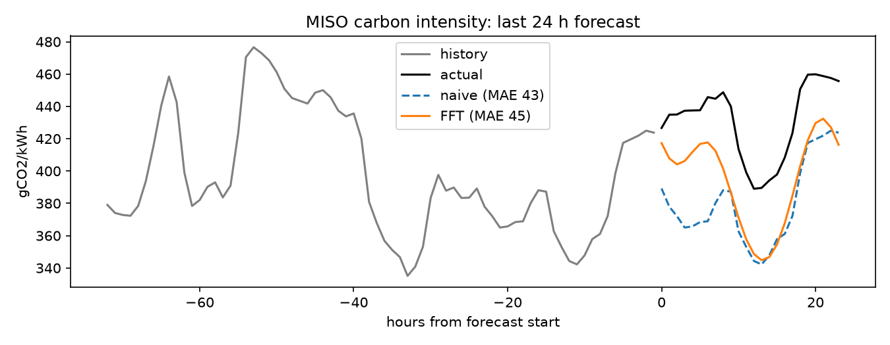

### Greenrun: Carbon-Aware Job Scheduler

Grid electricity is cleaner at some hours than others. In MISO (US Midwest) it ranged from <212 to 505> gCO2/kWh over the last 8 weeks.
Greenrun forecasts the grid's carbon intensity and runs your batch job in the cleanest window that meets your data.

```
greenrun --deadline 1d --hours 2 -- python train.py
Now: 444 gCO2/kWh. Cleanest start: 2026-11-03 17:00 UTC at 375 gCO2/kWh, saving ~41 g CO2 (15%)
```

## How it works
1. **Data**: hourly generation by fuel from the [EIA Open Data API](https://www.eia.gov/opendata/), stored in SQLite.
2. **Intensity**: generation-weighted average of IPCC AR5 lifecycle emission factors.
3. **Forecast**: FFT of the last whole weeks, keeping only daily data (24/12/8 h) and weekly cycles; benchmarked against "same hour yesterday".
4. **Schedule**: lowest-average window of the job's length that finishes before the deadline.
5. **Log**: each job's command, timing, and the intensity now vs at the chosen time.

## Results
Walk-forward backtest on 8 weeks of MISO data (MAE, gCO2/kWh):

| window | naive | FFT |
|---|---|---|
| 7 days | <29.7> | <33.9> |
| 21 days | <48.6> | <40.8> |



The FFT captures daily solar and weekly demand cycles but not wind fronts; weather features are next step

## Setup
```bash
pip install -e ".[dev]"
cp .env.example .env # add a free EIA API key
python scripts/backfill_eia.py 8
greenrun --deadline 12h --dry-run -- echo hello
pytest
```

## Limitations
- Uses **average** emissions; **marginal** emmisions are the better signal but aren't public
- CO2 saved assumes a constant power draw (`GREENRUN_POWER_KW`).
- `OTH` fuel is assumed to emit like natural gas.
